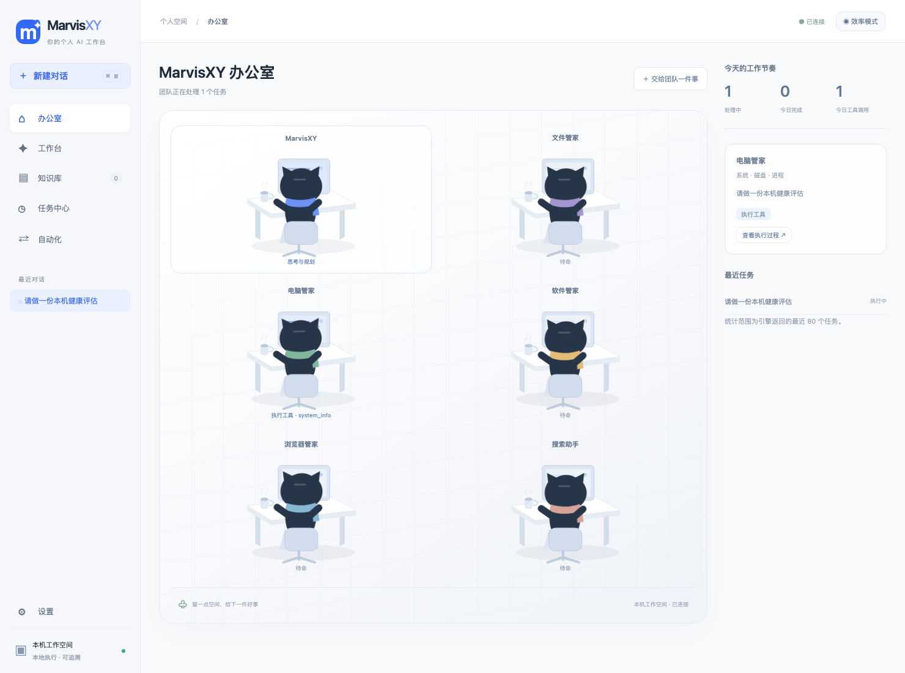
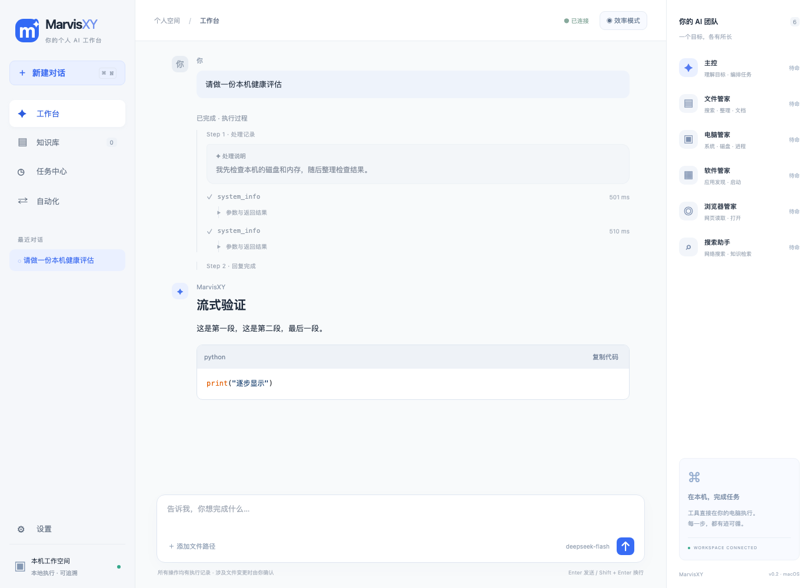
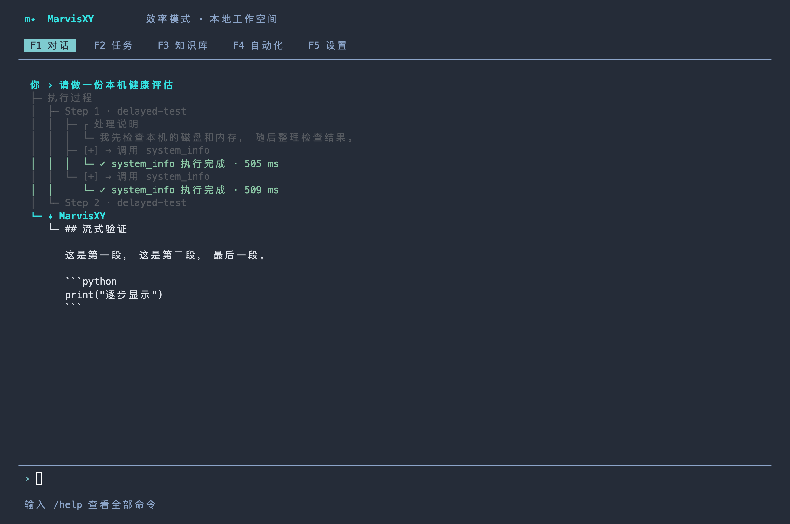

# MarvisXY

macOS 个人 AI 工作台与全屏交互式终端。桌面 App、浏览器工作台、TUI 和 CLI 使用同一个本机任务引擎，持久化保存会话、工具执行记录、知识库和定时工作流。

当前版本 **0.2.0** 是可运行的功能实现。具体支持范围与缺口见 [功能对照](docs/FEATURES.md)。

## 截图展示

### 动画办公室

六位管家的工位根据真实执行事件切换待命、规划、工具执行与等待确认状态；点击工位可查看当前任务。



### App 工作台

按 step 展示执行过程，工具结果可折叠；回复支持 Markdown 表格和代码高亮。



### TUI 交互式终端

全屏终端展示步骤、说明和工具调用，支持流式文字、命令补全与结果展开。



截图使用演示会话；App 图为桌面端共用的工作台界面，TUI 图由实际 curses 终端输出捕获。

## 启动

推荐 macOS 13+，Python 3.9–3.13。当前开发环境为 Apple Silicon / Python 3.9。

```bash
cd /Users/ice/project/marvis-xy
python3 -m venv .venv
.venv/bin/python -m pip install -r requirements-desktop.txt -r requirements-office.txt

# macOS 原生窗口（WKWebView，不是浏览器标签页）
.venv/bin/python main.py --app

# 全屏交互式终端
.venv/bin/python main.py --tui

# 不调用模型，验证本地工具
.venv/bin/python main.py --tui --offline

# 浏览器工作台 / 仅启动服务
.venv/bin/python main.py --web
.venv/bin/python main.py --serve

# 单轮 CLI / 逐行交互
.venv/bin/python main.py "检查磁盘空间"
.venv/bin/python main.py --interactive
```

不安装桌面和文档依赖时，TUI、CLI、HTTP 服务、文本搜索、CSV 转换和 SQLite 知识库仍可运行。PyYAML 用于读取集中配置，缺失时使用 `.env` 模型配置。

App 启动后，再启动 TUI 会自动复用同一后台引擎；TUI 关闭不影响 App。所有客户端必须使用相同 `--data-dir`。**启动后台引擎的进程退出时**任务和定时器停止，其余客户端会失去连接。若需要持续运行，可保持 `--serve` 在终端运行。暂未安装 launchd 常驻服务。

### 双击 App

```bash
.venv/bin/python scripts/build_local_app.py
```

生成 `dist/MarvisXY.app`，可在 Finder 双击。此开发版入口指向当前项目及 `.venv`，移动项目后需重新生成；不是可复制到其他电脑的独立分发包。首次安装的 Python/应用可能受到系统自身的 Gatekeeper 或文件访问权限限制。

## 界面

桌面工作台包含：

- **办公室**：六个动画工位，角色状态关联真实任务与工具事件；点击管家查看当前工作，打开对话查看执行过程。显示近期任务范围内的今日完成数、工具调用数与活动任务数，切出页面暂停动画，支持系统减少动态效果设置。
- **工作台**：自然语言对话、历史会话、文件搜索、系统检查和整理入口。助手回复与流式内容支持 Markdown 标题、粗体、列表、引用、表格、链接、代码高亮和代码复制；图片可点击放大。
- **知识库**：索引授权目录，按文件名与文本内容搜索，文档读取与图片 OCR 入口。
- **任务中心**：排队、执行、确认、完成、失败与取消状态，实际工具参数和结果。
- **自动化**：创建间隔工作流、手动运行、暂停、恢复、删除；提供磁盘巡检与索引模板。
- **设置**：效率/本地模式，模型端点和名称，文件授权目录。
- **团队状态**：主控与 File / Computer / App / Browser / Search 五类能力的执行状态。

采用主模型的结构化工具调用循环，按能力领域分发执行；当前不包含五个独立模型的并行对话上下文。任务按提交顺序执行，防止同一会话或文件操作相互冲突。

## TUI 操作

F1–F5 切换对话、任务、知识库、自动化、设置。Tab 切换页面，↑↓滚动；Ctrl+N 新会话，Ctrl+X 请求停止；Enter 提交，Ctrl+C 或 `/quit` 退出。支持中文字符宽度和输入编辑。输入 `/` 或命令前缀（如 `/ne`）会显示命令联想、参数提示和说明；↑↓选择候选，Tab补全，Esc收起，Enter提交。输入参数时不触发命令名补全；没有候选时 Tab 保留页面切换功能。终端至少 60×15。 TUI 按 step 显示弱化灰色的公开行动说明、生成中的工具调用和嵌套结果。增量文字以约 30 ms 的绘制节拍逐步显示，后台快照按 100 ms 更新，curses 仅提交屏幕差异。工具参数与结果默认折叠；Ctrl+R 进入工具选择，↑↓选择、Enter切换、←折叠、→展开、Esc返回输入；也可用 `/result N` 切换第 N 个工具（省略 N 选择最后一个）。支持鼠标事件的终端可点击工具条目。展开状态按调用 ID 保留，滚动查看历史时暂停自动跟随。

```text
/help
/tree
/result 1
/files "/Users/ice/project/marvis-xy" 搜索关键词
/read "/Users/ice/project/marvis-xy/README.md"
/write "/允许目录/note.md" "需要保存的完整内容"
/organize "/允许目录"
/approve
/reject
/duplicates "/允许目录"
/convert "/允许目录/data.csv" json
/index "/允许目录"
/search 文档关键词
/system disk
/system memory
/system battery
/apps
/open-app "Safari"
/web https://example.com
/web-search 查询关键词
/mode local
/model https://provider.example/v1 model-id
/roots "/工作目录" "/其他允许目录"
/workflow 60 "磁盘巡检" 检查磁盘空间
```

对话页默认实时显示规划状态、模型公开行动说明、工具调用参数、执行耗时与结果；App 通过认证 SSE 实时推送增量。每个 Agent step 显示模型公开行动说明气泡、工具调用和返回结果；说明气泡逐步显示，工具条目使用淡灰色，参数与返回结果嵌在条目下方、默认折叠。工具参数生成期间即可显示调用条目，后续状态与结果更新保留展开状态。界面复用已有 DOM 节点，通过 requestAnimationFrame 平滑显示文本并跟随滚动；向上滚动会暂停跟随。完成后显示正式回复。连接失效时降级为轮询，自动重连。若模型服务忽略流式请求并一次返回全文，执行过程会明确标注本轮未提供分段输出。`/trace` 可以收起或展开过程，F2 保留完整执行记录。对话采用树状缩进，参数和结果归属对应的工具调用；中文长行换行后保留层级。用户消息为青色、工具为蓝色、成功为绿色、错误为红色；处理说明使用弱化灰色（终端不支持文字 alpha 透明度）。显示的是处理说明和真实事件，不展示模型私有推理字段。更新此功能后须退出旧 App / TUI / 后台引擎再启动，避免复用旧引擎。

`/tree` 打开当前会话的分支导航器：↑↓选择节点，←折叠或回到父节点，→展开，Enter跳转，Esc返回。直接输入文字搜索，Ctrl+U清空搜索，Ctrl+O切换全部／用户／书签筛选，按大写 L 编辑节点书签。● 标记当前节点，• 标记当前分支路径。选择用户消息会将原文放回输入框，修改后重发生成新分支；选择助手回复可从该处继续追问，选择会话起点可另开分支。旧分支全部保留，也可用 `/tree 节点ID` 直接跳转（支持唯一前缀）。任务执行期间须先完成或停止任务才能切换分支。跳转改变后续对话上下文，已经执行的文件操作不会撤销。已有线性会话会自动迁移为树；首次更新须退出旧引擎并重新启动。

完整命令见 `/help`，工作流与任务 ID 可在对应页面查看。包含空格的路径和名称用引号包裹。普通 CLI 也可使用精确结构化命令：

```bash
.venv/bin/python main.py '/tool file_list {"path":"/Users/ice/project/marvis-xy","query":"README"}'
```


## 模型与运行模式

App 图片支持 Markdown ``、PNG/JPEG/GIF/WebP 的 base64 data URL，以及 ``（相对路径按项目工作目录解析）。本地图片经认证接口读取，沿用目录授权与凭据排除规则，上限 10 MB；本地模式不加载远程图片。渲染库随项目打包，界面不依赖 CDN。Markdown 内的 HTML 经清洗后显示。

沿用 `config.yaml` 的模型与人设配置。密钥只放 `.env`，不会显示在 UI 或存入设置数据库。

```dotenv
OPENAI_BASE_URL=https://your-provider.example/v1
OPENAI_API_KEY=your-key
OPENAI_MODEL=your-model
```

配置优先级：界面保存的端点/模型 > `config.yaml` > `.env` > 进程环境变量。`config.yaml` 自带的端点/模型若不适合你的供应商，请在设置中修改或删去 YAML 对应项。自然语言复杂任务通过 OpenAI 兼容 `/chat/completions` 和 function calling 执行；最多八轮工具调用，失败明确显示，不虚构执行结果。

- **效率模式**：模型可在远程运行，任务和工具结果可能发送给已配置的模型服务。工具动作本身在本机执行。
- **本地模式**：模型固定使用 `http://127.0.0.1:11434/v1` 的 Ollama `qwen3:latest`，不沿用云端 Key，禁用网页读取、网页搜索和打开联网网页；模型重定向被拒绝。需要你提前安装 Ollama 并下载该模型。简单本地工具无需模型。
- `--offline`：禁用模型调用，不等于禁用网络工具；网络工具由本地/效率模式控制。连接已有引擎时沿用其模式。


## 文件与执行保护

默认只授权项目目录。在设置或 `/roots` 中添加具体工作目录。路径解析后检查授权边界，拒绝通过符号链接越界，排除 `.env`、凭据目录与自身数据库。

创建、转换、移动文件和打开应用/浏览器先展示具体计划，再等待用户确认；拒绝和取消不会执行待确认操作。确认五分钟后超时。写入与转换不覆盖现有文件；整理确认后重新检查文件大小、修改时间及目标冲突，移动失败尝试回滚已移动文件。整理目前按类型对一层散落文件归类，不提供删除和通用撤销。

文件检索最多扫描 5000 个文件，返回前 100 个结果；文档读取上限 20 MB / 100000 字符。图片索引仅包含文件名和元数据。OCR 需要系统安装 `tesseract` 与 `chi_sim+eng` 语言包。

本机 HTTP API 仅绑定 `127.0.0.1`，要求随机令牌，并检查 Host 和 Origin。访问地址中的令牌及 `.marvis/endpoint.json` 不应分享。`endpoint.json` 以 0600 创建。**不要将此服务反向代理到公网。** 当前未实现远程身份认证、TLS 或移动设备配对。

任务取消是协作式的：正在执行的网络请求或单个工具需要返回后才停止，已经完成的文件变更不会因取消自动撤销。切换设置前需要完成或取消活动任务。重启引擎会将未完成任务标记中断，不重放文件修改；工作流在重启后补一次到期执行，不补跑所有错过的间隔。

## 项目结构

```text
main.py                  App / Web / TUI / CLI 统一入口
marvis/runtime.py        任务队列、确认、模型编排、工作流调度
marvis/capabilities.py   文件、文档、系统、应用、网页、搜索工具
marvis/store.py          SQLite 持久化
marvis/server.py         本机 API 与工作台静态资源
marvis/client.py         复用已有后台引擎的客户端
marvis/desktop.py        macOS WKWebView 宿主
marvis/tui.py            curses 全屏终端
ui/                      无 CDN、无构建依赖的工作台前端
scripts/build_local_app.py  生成本地开发 .app 入口
agent.py, agents/        保留旧版 Agent 原型，当前入口不执行旧版路径
llm_client.py            OpenAI 兼容接口客户端
```

运行数据保存在 `.marvis/`，可通过 `--data-dir` 改为其他目录；敏感文件和数据目录已加入 `.gitignore`。原 `.env` 未被修改。

## 验证

```bash
.venv/bin/python -m unittest discover -s tests -v
node --check ui/app.js
```

测试覆盖路径与符号链接、确认/拒绝/取消、整理过期计划、格式转换、知识检索与持久化、真实 Word/Excel/PDF 解析、模型工具调用、消息顺序、工作流调度、HTTP 认证与双客户端复用。文档测试在未安装可选依赖时跳过。接口测试需要允许绑定本机临时端口。

当前原生窗口已成功启动，TUI 已做中文输入、写入批准和任务记录的实际交互验证。浏览器与原生窗口的自动视觉/点击验收受本轮工具权限限制，尚未完成。
